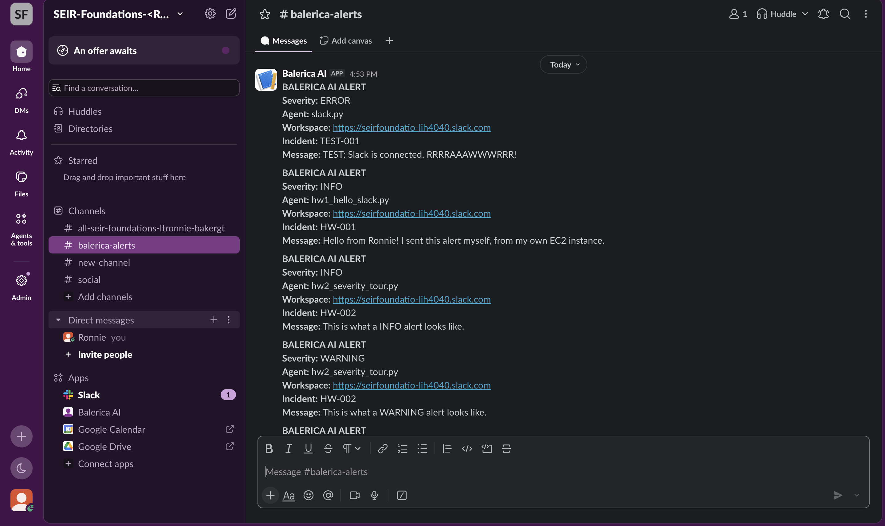
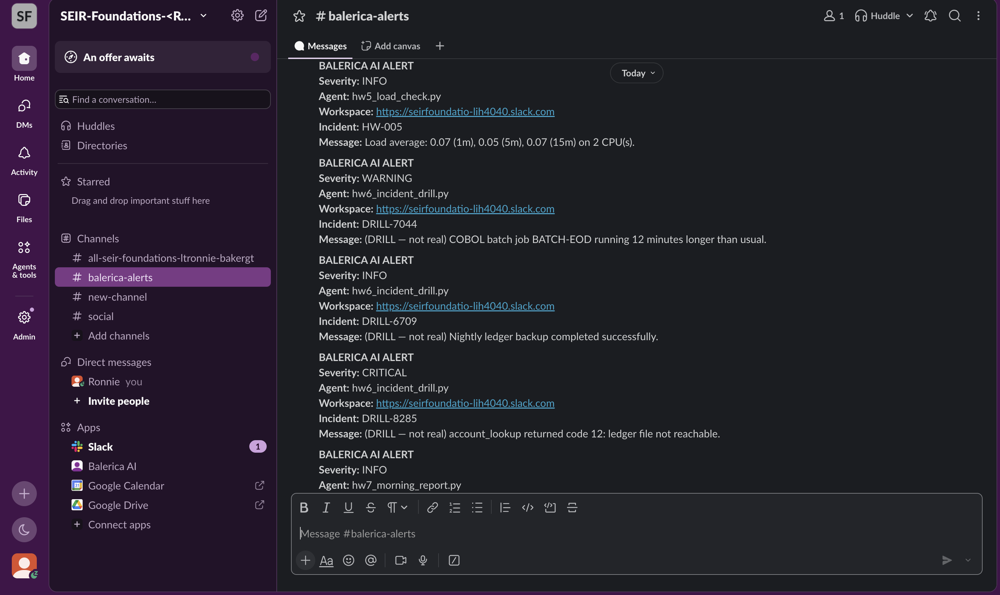
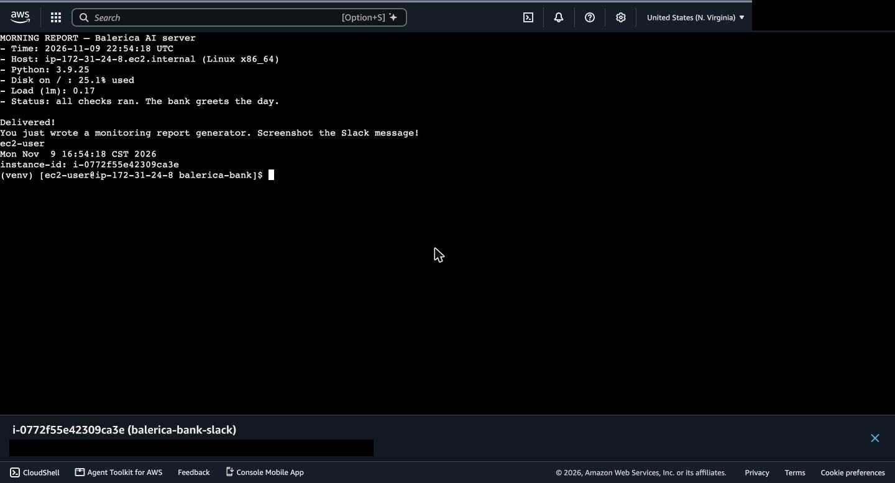

# Lesson 2 — Seven Alerts, Seven Wins (Slack)

**Student:** Ronnie Baker  
**Time zone:** America/Chicago  
**Week:** 4 (Assigned Tue 11/03/26, Due Mon 11/09/26)  
**Assignment:** [SEIR-Foundations / module1/lesson2_slack/homework](https://github.com/BalericaAI/SEIR-Foundations/tree/main/module1/lesson2_slack/homework)

## Run Record

| Date | Time zone | Instance ID | Region / type | Slack channel | Scripts run | Terminated? |
|---|---|---|---|---|---|---|
| 11/9/2026 | America/Chicago | `i-0772f55e42309ca3e` | us-east-1 / t3.micro (Amazon Linux 2023) | `#balerica-alerts` | hw1–hw7 (hw6 ×3) + experiments 1–4 | Yes |

Prerequisite check: `python slack.py --test` → `SUCCESS: Chewbacca approves!`, and the alert appeared in `#balerica-alerts`.

## Evidence of Completion

| Requirement | File |
|---|---|
| Screenshot of `#balerica-alerts` with at least 5 different homework alerts | [slack_alerts_1.png](screenshots/slack_alerts_1.png) – [slack_alerts_5.png](screenshots/slack_alerts_5.png) |
| Terminal running `hw7_morning_report.py` with the Lesson 1 ID line (`whoami && TZ='America/Chicago' date && ec2-metadata -i`) | [hw7_morning_report.jpg](screenshots/hw7_morning_report.jpg) |
| Notes: five "In your notes:" answers (hw2–hw6) + experiment 1 prediction vs. result | [lesson2_notes.md](lesson2_notes.md) |

### Slack alerts in `#balerica-alerts`

| Screenshot | Alerts shown |
|---|---|
| [slack_alerts_1.png](screenshots/slack_alerts_1.png) | `slack.py --test` (ERROR), hw1 (INFO), hw2 INFO, hw2 WARNING |
| [slack_alerts_2.png](screenshots/slack_alerts_2.png) | hw2 ERROR, hw2 CRITICAL, hw3 (INFO), hw4 (INFO) |
| [slack_alerts_3.png](screenshots/slack_alerts_3.png) | hw5 (INFO), hw6 DRILL-7044 (WARNING), DRILL-6709 (INFO), DRILL-8285 (CRITICAL) |
| [slack_alerts_4.png](screenshots/slack_alerts_4.png) | hw7 morning report, experiment 1 (CRITICAL only), experiment 3 (hw4 → WARNING) |
| [slack_alerts_5.png](screenshots/slack_alerts_5.png) | Experiment 1 and 3 alerts, then the final hw7 morning report (the one in the terminal screenshot) |

### hw7 morning report + ID line

ID line output: `ec2-user` · `Mon Nov 9 16:54:18 CST 2026` · `instance-id: i-0772f55e42309ca3e`

## Experiment 1 at a glance

| Setting | Prediction | Result |
|---|---|---|
| `SLACK_ALERT_SEVERITY=CRITICAL`, rerun hw2 | 1 of 4 arrives (CRITICAL) | INFO, WARNING, ERROR skipped; CRITICAL delivered ✅ |

Full answers to all five notes questions and experiments 2–4 are in [lesson2_notes.md](lesson2_notes.md).

## Sensitive info hidden

- No webhook URL, `.env` contents, keys, or passwords appear in any file or screenshot.
- In `hw7_morning_report.jpg` the AWS account ID (top right) and the instance's public/private IP line are blacked out. The ID line is still visible.
- All Slack messages are synthetic (hw6 incidents are marked DRILL).

## Cleanup

- Instance `i-0772f55e42309ca3e` terminated, and its root volume was deleted with it (Volumes page shows none in us-east-1).
- Security group `launch-wizard-1` deleted.
