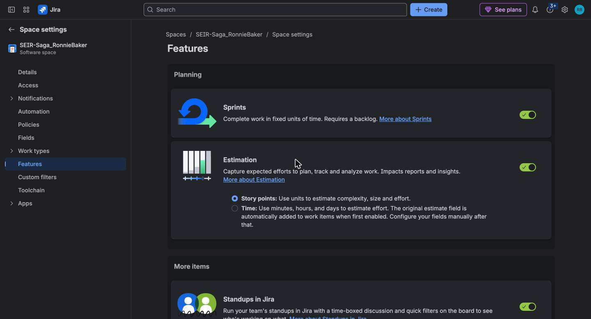
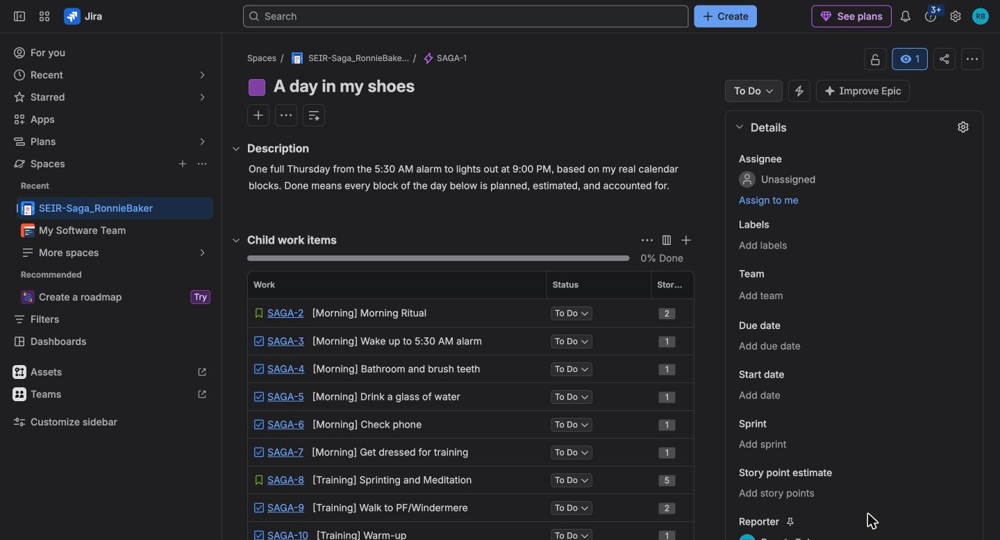
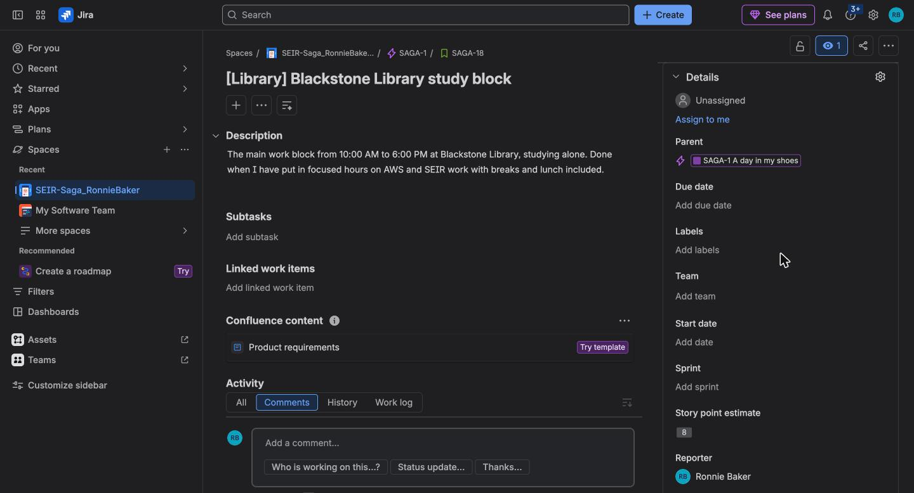
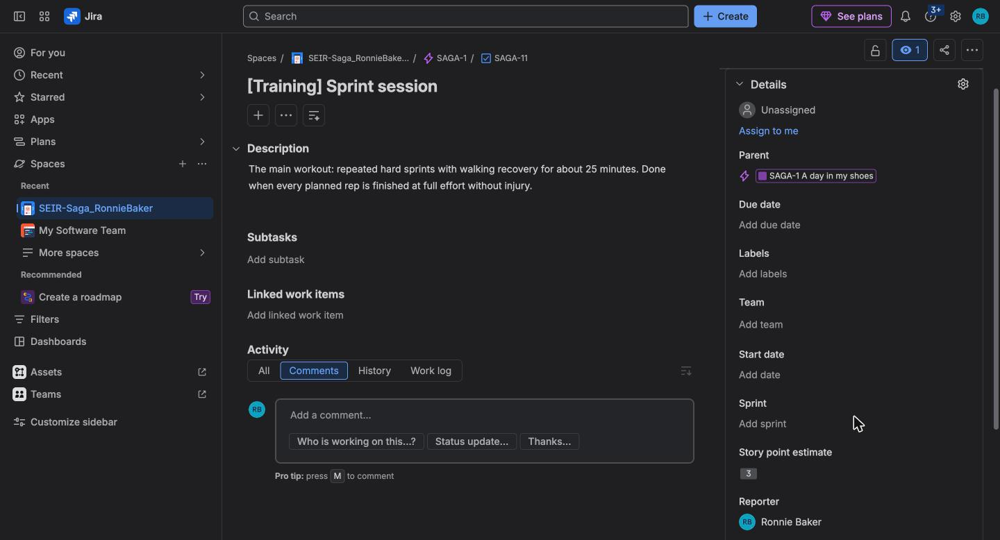
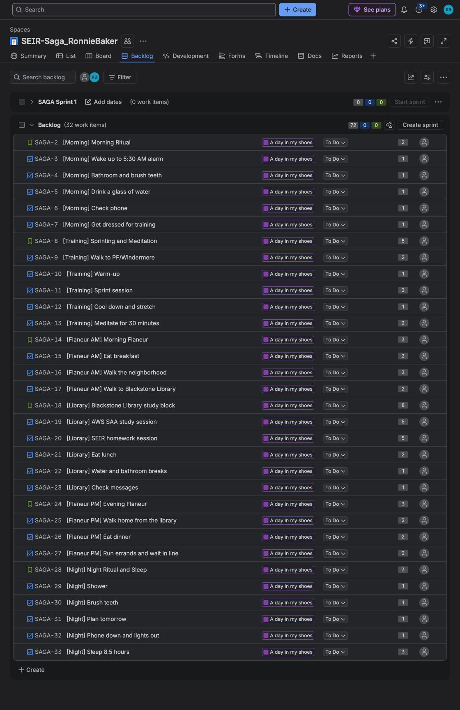

# Lesson 3 — Jira, A Day in My Shoes

**Student:** Ronnie Baker  
**Time zone:** America/Chicago  
**Week:** 5 (Assigned Tue 11/10/26, Due Tue 11/17/26 12:00 PM ET)  
**Assignment:** [SEIR-Foundations / module1/lesson3_Jira](https://github.com/BalericaAI/SEIR-Foundations/tree/main/module1/lesson3_Jira)

## Space

| Field | Value |
|---|---|
| Space name | `SEIR-Saga_RonnieBaker` |
| Space key | `SAGA` |
| Template | Scrum, team-managed |
| Estimation | ON, Story points |
| Site | rcwbaker.atlassian.net |

The day is a real Thursday taken from my calendar: Morning Ritual 5:30, Sprinting 6:00, Meditation 6:45, Flaneur 7:15–10:00, Blackstone Library 10:00–6:00, Flaneur 6:00–8:30, Night Ritual 8:30, Sleep 9:00.

**Point scale:** 1 = a few minutes and no effort, 2 = a short block or a meal, 3 = an hour or more or physically hard, 5 = deep focused work for hours. Stories are sized by the whole block (8 = the longest, hardest block of the day).

## Evidence Table

| Key | Type | Summary | Story points |
|---|---|---|---|
| SAGA-1 | Epic | A day in my shoes | — |
| SAGA-2 | Story | [Morning] Morning Ritual | 2 |
| SAGA-3 | Task | [Morning] Wake up to 5:30 AM alarm | 1 |
| SAGA-4 | Task | [Morning] Bathroom and brush teeth | 1 |
| SAGA-5 | Task | [Morning] Drink a glass of water | 1 |
| SAGA-6 | Task | [Morning] Check phone | 1 |
| SAGA-7 | Task | [Morning] Get dressed for training | 1 |
| SAGA-8 | Story | [Training] Sprinting and Meditation | 5 |
| SAGA-9 | Task | [Training] Walk to PF/Windermere | 2 |
| SAGA-10 | Task | [Training] Warm-up | 1 |
| SAGA-11 | Task | [Training] Sprint session | 3 |
| SAGA-12 | Task | [Training] Cool down and stretch | 1 |
| SAGA-13 | Task | [Training] Meditate for 30 minutes | 2 |
| SAGA-14 | Story | [Flaneur AM] Morning Flaneur | 3 |
| SAGA-15 | Task | [Flaneur AM] Eat breakfast | 2 |
| SAGA-16 | Task | [Flaneur AM] Walk the neighborhood | 3 |
| SAGA-17 | Task | [Flaneur AM] Walk to Blackstone Library | 2 |
| SAGA-18 | Story | [Library] Blackstone Library study block | 8 |
| SAGA-19 | Task | [Library] AWS SAA study session | 5 |
| SAGA-20 | Task | [Library] SEIR homework session | 5 |
| SAGA-21 | Task | [Library] Eat lunch | 2 |
| SAGA-22 | Task | [Library] Water and bathroom breaks | 1 |
| SAGA-23 | Task | [Library] Check messages | 1 |
| SAGA-24 | Story | [Flaneur PM] Evening Flaneur | 3 |
| SAGA-25 | Task | [Flaneur PM] Walk home from the library | 2 |
| SAGA-26 | Task | [Flaneur PM] Eat dinner | 2 |
| SAGA-27 | Task | [Flaneur PM] Run errands and wait in line | 2 |
| SAGA-28 | Story | [Night] Night Ritual and Sleep | 3 |
| SAGA-29 | Task | [Night] Shower | 1 |
| SAGA-30 | Task | [Night] Brush teeth | 1 |
| SAGA-31 | Task | [Night] Plan tomorrow | 1 |
| SAGA-32 | Task | [Night] Phone down and lights out | 1 |
| SAGA-33 | Task | [Night] Sleep 8.5 hours | 3 |

**Counts:** 1 epic, 6 stories, 26 tasks. Every story and task has SAGA-1 as its Parent, a Story point estimate, and a description of at least 2 sentences.  
**Total story points:** 72 (stories 24 + tasks 48)

### Biggest task

My biggest tasks are the two 5-point library sessions, AWS SAA study (SAGA-19) and SEIR homework (SAGA-20). I gave them the top task score because each one is two to three hours of focused work where I have to finish a section and check what I got wrong, not just show up. Physical tasks like the sprint session got a 3 because they are hard but short, so effort and length together decide the number, not only how tired I feel afterward.

## Screenshots

| Requirement | File |
|---|---|
| Features page with Estimation ON and Story points selected | [jira_estimation_on.jpg](screenshots/jira_estimation_on.jpg) |
| Epic opened, child items with their points | [jira_epic.jpg](screenshots/jira_epic.jpg) |
| Story opened (SAGA-18) with Parent, description, Story point estimate | [jira_story.jpg](screenshots/jira_story.jpg) |
| Task opened (SAGA-11) with Parent, description, Story point estimate | [jira_task.jpg](screenshots/jira_task.jpg) |
| Backlog showing all stories and tasks with points | [jira_backlog.jpg](screenshots/jira_backlog.jpg) |

`jira_backlog.jpg` is three scrolls of the same backlog page joined top to bottom so all 32 items fit in one image.

